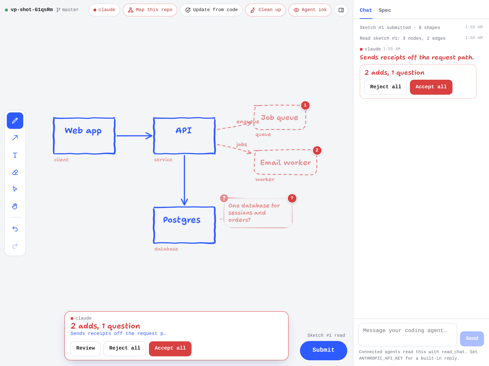
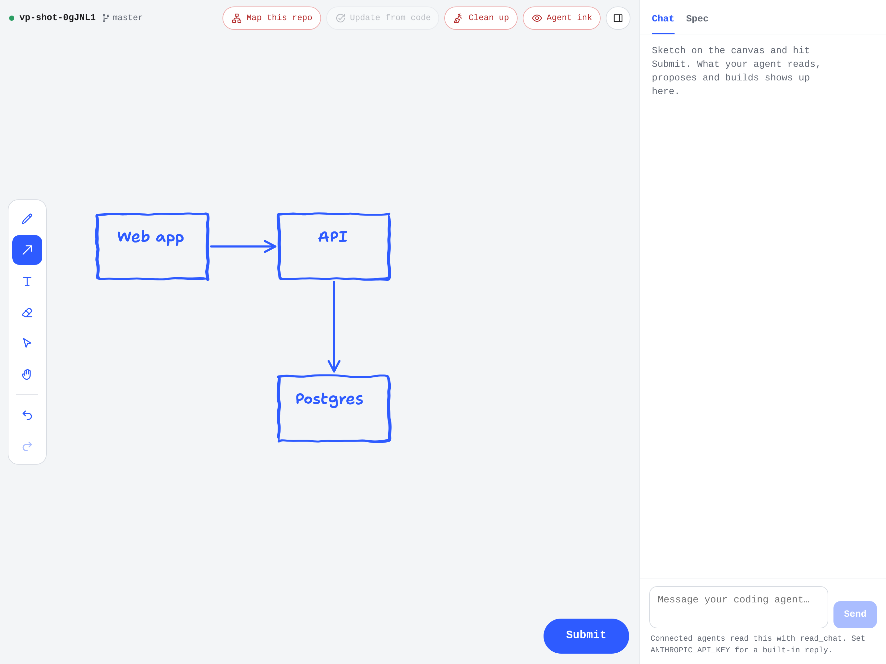
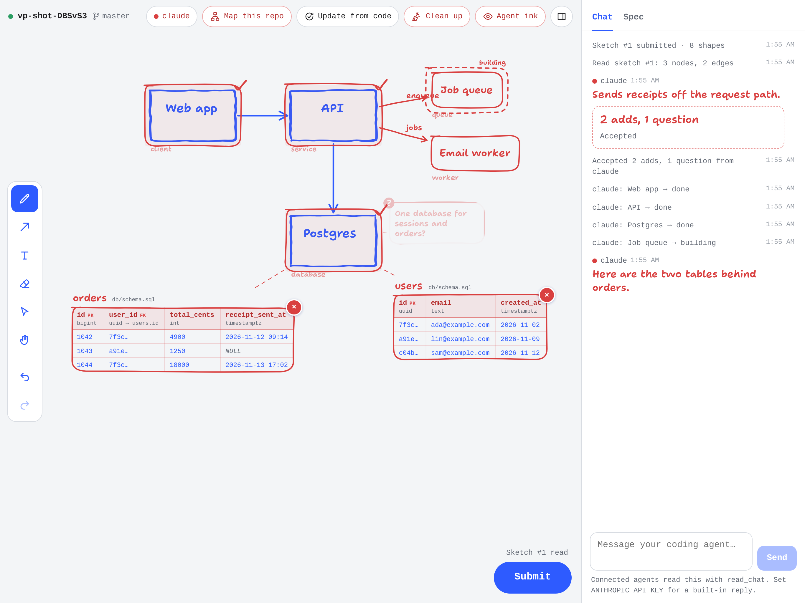
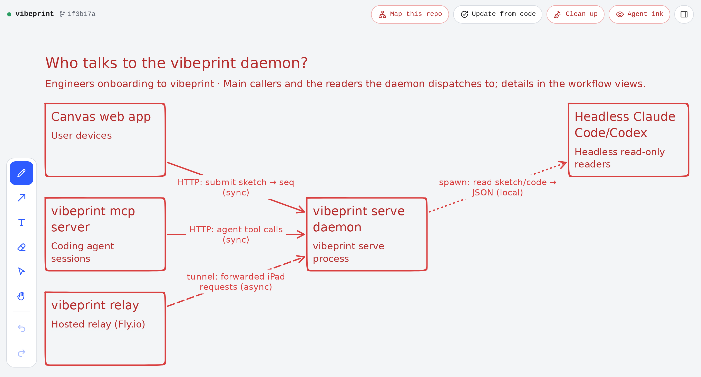

# vibeprint

**Your sketch becomes the spec.** Draw your architecture on an iPad. Claude Code or Codex reads the drawing, suggests changes in red ink, and marks each box built as the code lands.



```sh
npx vibeprint@latest init    # in your project: .vibeprint/, the agent rule, .mcp.json
npx vibeprint@latest         # starts the canvas and prints a QR code for the iPad
```

Free and MIT licensed. One MCP server works with any agent. The drawing lives in your repo as plain JSON.

## How it works

### 1. You sketch

Draw boxes, arrows and words with the Pencil (or a finger, or a mouse), then tap **Submit**. Vibeprint reads the drawing into a graph of components and connections, and each one stays tied to the ink it came from. Small tags like *service* or *database* show what it understood. If a tag is wrong, scribble a fix and submit again.



### 2. The agent suggests, you decide

The agent never edits your drawing. It works in its own red pen, beside your ink: it adds components, strikes things out, rewrites labels and pins questions in the margin. Suggestions arrive in small batches ("2 adds, 1 question"). Accept a batch with one tap, or go through it item by item. An accepted strike dims your shape and leaves it on the canvas. One button hides all agent ink.

The rule `init` gives your agent: *read the architecture before starting work; if the build needs a structural change, propose it and wait for approval; never deviate silently.*

### 3. The build shows up on the drawing

As code lands, the agent marks components done, building or blocked. Built boxes get a red outline and a check. **Update from code** has a model check the code against the drawing and suggest whatever is missing. Ask what's in a database and its tables appear beside it: the columns come from your schema, and the example rows are made up to fit.



### 4. Start from the code you already have

**Map this repo** draws your project's existing architecture: apps, services, workers, databases, third-party APIs and how they connect. A quick map from the folder layout and imports appears at once. Then Claude Code, Codex or the Claude API reads the code and redraws the map properly, in a few minutes. Sketch your changes on top.



## Quick start

Requires Node 20+.

```sh
cd ~/code/my-app
npx vibeprint@latest init     # .vibeprint/, the agent rule in AGENTS.md, .mcp.json for Claude Code
npx vibeprint@latest          # prints a laptop URL, an iPad URL and a QR code
```

Or install it: `npm install -g vibeprint`, then `vibeprint init` and `vibeprint`. With npx, keep the `@latest`, or npx keeps running the copy it cached the first time. When a newer release is out, the banner and the canvas tell you.

**On the iPad:** scan the QR code, then tap **Share → Add to Home Screen** for a full-screen canvas. The iPad link carries an access token. It stays the same across restarts, so the home-screen icon keeps working.

**Any network:** vibeprint also connects out to a hosted relay, so the iPad can reach it from anywhere: a cloud VM, office Wi-Fi that isolates devices, or a phone hotspot. The banner prints a second link, `https://<id>.live.vibeprint.viraat.dev/?t=…`. Each repo gets its own subdomain. The relay stores nothing; it forwards requests, and your machine still checks the token on every one. `--no-relay` keeps everything on your network. The relay's source is in [`relay/`](relay/server.mjs).

**Connect Codex** (Claude Code picks up `.mcp.json` by itself):

```sh
codex mcp add vibeprint -- vibeprint mcp     # or: vibeprint init --register
```

The MCP server works with or without the canvas running. With the canvas up, marks stream onto the iPad live. Without it, the server reads and writes `.vibeprint/` directly.

Run it from the checkout you're working in. Each folder, whether a clone or a `git worktree`, gets its own canvas, and the top bar shows the folder and branch.

## In Rudder

[Rudder](https://rudder.exla.ai) runs vibeprint as a **Canvas** panel beside each project's agents. Each project gets one canvas, and its state is kept outside the repo, so the agents never see it. **Send to agent** hands the drawing to an agent as a message you choose to send. With tracking on, Rudder checks each agent's changes against the canvas after its turns and updates the build status. Under the hood this is `vibeprint serve --state <dir> --embed-origin <rudder>` plus `POST /api/track`. Any host app can do the same.

## Details

### Reading a sketch

With `ANTHROPIC_API_KEY` set, Claude reads your handwriting directly. Without it, the Claude Code or Codex installed on the machine reads the picture, headless and read-only. With neither, a built-in heuristic reads shapes, arrows and typed text (handwriting comes out as "Box 1", "Box 2"), and your coding agent does the full reading with `get_sketch` and `interpret` the next time it checks the architecture.

Marks appear only after your pen has been still for a moment, drawn one at a time like a second pen. Pending marks are faded and dashed; accepted ones turn solid. Accept or reject from the iPad (tap a numbered badge, or **Review** / **Accept all**) or from the laptop's chat panel. Questions arrive as margin notes; answer by writing beside them and submitting again.

### Map this repo

1. **The quick map** takes well under a second and needs no model. Components come from the folder layout and package manifests, connections from imports between them, and databases, queues and third-party APIs from the packages each component uses.
2. **The model map** comes from a model that reads the code, checks its draft against the files it cites, and redraws the map in place. That model is the Claude API if `ANTHROPIC_API_KEY` is set, otherwise Claude Code (limited to Read, Grep and Glob) or Codex (in its read-only sandbox). The top bar shows **Reading the code…** meanwhile. If you edit the quick map before it finishes, your edits win.

The map is ordinary editable ink, with every component marked done. It covers entry points, request and job paths, storage and failure handling, with labeled arrows (solid for requests, dashed for async delivery, dotted for local I/O) and source-linked notes. Large projects split into focused views; switch between them with the **Diagram view** selector. Maps can include **Project facts** and **Project activity** views when the code has useful evidence. Activity shows real numbers only when you supply them (see below), and **Not measured** otherwise. Boxes you draw afterwards count as planned work. Mapping again replaces an unedited map; an edited map stays and the new one goes beside it. Connected agents can correct the map with marks or redraw it with `map_architecture`.

Recorded activity: a collector or your agent can write `.vibeprint/observations.json` (`{ "metrics": [...] }`) or pass `map_architecture.metrics`. Each metric has `id`, `label`, `definition`, `unit`, `source` and `reading: { value, at, window, scope, source }`. Use aggregate values only, never credentials or user records. These are snapshots with their times shown, not live counters. Remap to refresh them.

**Clean up** redraws a messy canvas from its image, the approved architecture, recent chat and the code. It answers the questions the code can settle and keeps the rest open. Your original ink stays blue and is kept in an **Original notes** area. **Undo cleanup** restores the original, even after a restart. **Update from code** marks components built, building, blocked or planned, and proposes whatever the drawing lacks as one batch. A host app can trigger the same check after an agent's turn by posting its diff to `POST /api/track` with `author` and `task`.

How good the maps are: the [evaluation report](evaluations/2026-11-04/README.md), [gallery](evaluations/2026-11-04/index.html) and [Offstage follow-up](evaluations/2026-11-05/README.md) keep real generate → render → review rounds, scored by Claude Opus 5.5 on screenshots and source. The scores apply to those examples only. To run a round: `node --import tsx scripts/evaluate-maps.ts <round>`, or `scripts/iterate-maps.ts` to keep going until every map scores 36/40.

### Tables

Each database on the map gets a **Tables** button. The model finds the schema in the code (migrations, ORM models, `schema.prisma`, `schema.sql`) and draws the tables beside the database, with column types, primary and foreign keys, and a few example rows. The columns are real; the rows are made up to fit. Asking in the chat ("show me the schema") works too, and so does your coding agent with `show_table`. Tap a table's × to remove it.

### Drawing

Tools: pen, arrow, text, eraser, select, pan, undo and redo. With an Apple Pencil, the Pencil draws with pressure and fingers move the canvas: one finger pans, two pinch to zoom, and a quick two-finger tap undoes. Without a stylus, a finger draws. Arrows attached to a box follow it when it moves. Paste or drop images onto the canvas. Keyboard: `D` `A` `T` `E` `V` `H` pick tools, space-drag pans, ⌘Z / ⇧⌘Z undo and redo, ⇧1 fits the drawing. Every open device shows the same drawing live.

On a laptop the canvas has a side panel. **Chat** talks to the built-in assistant if an API key is set, or to your coding agent through `read_chat` / `post_chat`. **Spec** shows the approved architecture with build progress.

## MCP tools

| Tool | What it does |
| --- | --- |
| `get_architecture` | The approved architecture: nodes, edges, statuses, pending proposals, open questions, recent decisions. |
| `get_node` | One node or edge with its connections, ink and marks. Ids or labels work. |
| `get_sketch` | The latest sketch as an image plus shape data, for agents doing the interpretation. |
| `interpret` | Set the graph for the latest sketch (nodes bound to shape ids, edges, tags, up to two questions). |
| `map_architecture` | Draw the code's existing components and connections as the architecture, marked done. Pass what the agent read, or nothing to use the built-in scan. |
| `add` | Propose a new component next to a node, optionally wired in, or a new edge between existing nodes. |
| `strike` | Propose removing a node or edge. Accepted strikes dim the ink. |
| `rewrite` | Propose a corrected label or kind. |
| `annotate` | Pin a margin note or question to a node, edge, or spot. |
| `set_status` | Report progress: `planned`, `building`, `done`, `blocked`. Lands immediately. |
| `show_table` | Draw tables beside a database: columns with types and keys, and example rows. Lands immediately; the user can remove it. |
| `propose` | Several marks as one batch. |
| `finish_batch` | Mark your current batch ready for review. |
| `list_marks` | Marks and their outcomes. |
| `read_chat`, `post_chat` | Talk with the user through the laptop panel. |
| `wait_for_user` | Block until the user submits, chats, or decides on your marks. |

Batches hold at most 6 marks, and an agent can have at most 12 waiting for review. Past that, the server tells the agent to wait.

## What's in `.vibeprint/`

| File | Contents |
| --- | --- |
| `canvas.json` | Your ink: one shape per line, sorted by id, so diffs show which shapes changed. |
| `sketch.json`, `sketch.png` | What was sent at the last submit. |
| `graph.json` | The interpreted architecture: nodes bound to shape ids, edges, statuses, accepted changes. |
| `marks.json` | Every agent mark (`author`, `batchId`, `type`, `target`, `status`) and the batches they came in. |
| `chat.json` | The chat panel history. |
| `observations.json` | Optional recorded activity for the map (see above). |
| `assets/` | Images pasted onto the canvas. |
| `runtime/` | Port, access token, relay address and cleanup backups. Git-ignored. |

The canvas commits `.vibeprint/` (and nothing else) after a submit, an interpretation and each round of decisions. Anything else you have staged stays staged. It skips commits during a merge or rebase; turn them off with `--no-commit`.

## Configuration

| | |
| --- | --- |
| `vibeprint serve --port 4747 --host 0.0.0.0` | Where the canvas listens. `--host 127.0.0.1` keeps it off the network. |
| `--no-commit` | Write `.vibeprint/` but never commit. |
| `--state <dir>` | Keep the canvas in `<dir>` instead of `.vibeprint/`. The repo is only read: nothing is written into it or committed. |
| `--embed-origin <origin>` | Let these sites (comma-separated) show the canvas in a frame. The frame's link carries the token in its fragment (`/#t=…`). |
| `--no-relay`, `VIBEPRINT_RELAY` | Turn off the hosted relay, or point it at your own (`VIBEPRINT_RELAY=https://relay.example.com`). |
| `ANTHROPIC_API_KEY` | Use Claude for reading sketches and the chat panel. |
| `VIBEPRINT_MODEL` | Model for reading sketches and chat (default `claude-opus-5-5`). |
| `VIBEPRINT_MAPPER` | What reads the code for **Map this repo**, **Clean up**, **Tables** and **Update from code**, and reads sketches without an API key: `api`, `claude`, `codex`, or `off` for the quick map only (default: the first available, in that order). |
| `VIBEPRINT_NO_UPDATE_CHECK` | Skip the check for a newer release at startup. |
| `VIBEPRINT_AUTHOR` | Override the author name an MCP client's marks carry (default: detected `claude` / `codex`). |

## Development

```sh
npm install
npm run dev        # daemon on :4747 (tsx watch) + Vite on :5173 with HMR
npm test           # node:test via tsx
npm run typecheck
npm run build      # dist/cli.js + dist/web
```

Layout: `src/core` (state, merge, placement), `src/server` (HTTP, canvas sync, git checkpoints), `src/interpret` (sketch and code readers), `src/mcp` (MCP server), `src/cli` (`init`), `web/` (the canvas app), `src/shared` (shared types). `scripts/screenshots.ts` takes the README screenshots (`sketch`, `review`, `tables`, `map`).

## License

MIT, canvas included. Pen strokes come from [perfect-freehand](https://github.com/steveruizok/perfect-freehand) (MIT) and text uses Shantell Sans (SIL OFL 1.1). No license keys anywhere.
